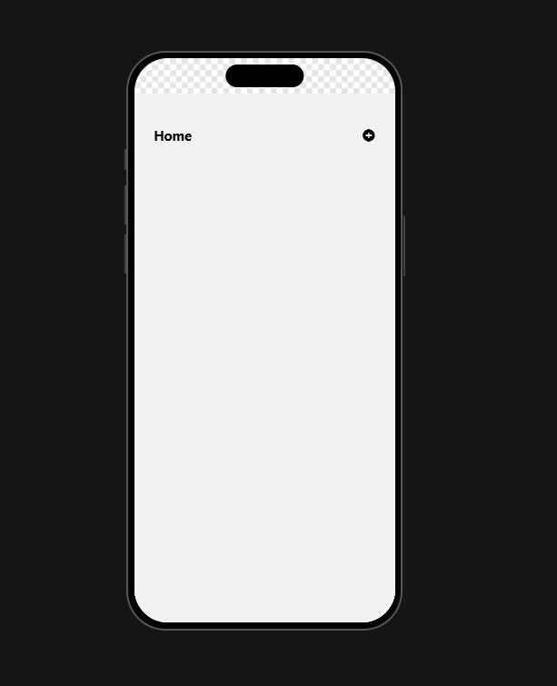
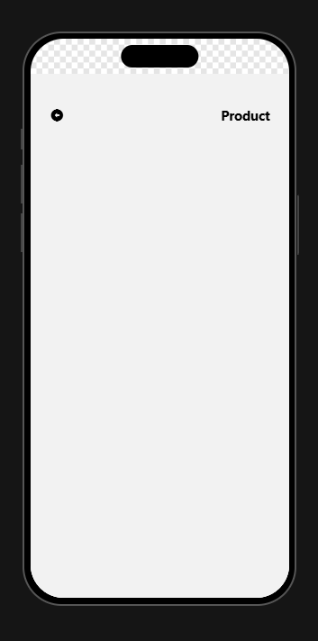
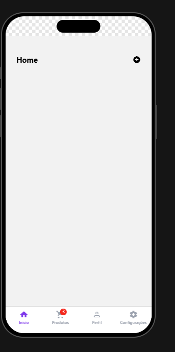
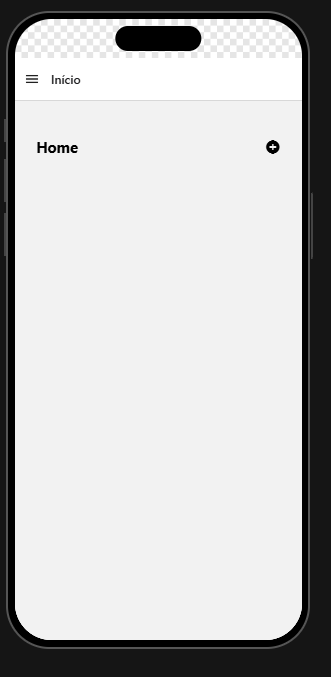

# My App — React Navigation

**Desenvolvedor:** Michael Gouveia de Oliveira

## Sobre o projeto

Aplicativo desenvolvido com React Native e Expo para praticar três tipos de navegação utilizando React Navigation.

- **Stack Navigation:** navegação entre Home e Product, com retorno à tela anterior.
- **Bottom Tabs Navigation:** barra inferior com Início, Produtos, Perfil e Configurações. A aba Produtos apresenta um indicador vermelho com o número 3.
- **Drawer Navigation:** menu lateral com as opções Início, Produtos, Perfil e Configurações.

## Tecnologias utilizadas

- React Native
- Expo
- JavaScript
- React Navigation
- React Native Gesture Handler
- React Native Reanimated
- Material Icons

## Como executar o projeto

**Pré-requisitos:** Node.js e npm instalados.

Clone o repositório:

```bash
git clone https://github.com/michaelgvo33/my-app2.git
```

Entre na pasta:

```bash
cd my-app2
```

Instale as dependências:

```bash
npm install
```

Inicie o aplicativo:

```bash
npx expo start
```

## Modos de navegação

Para selecionar o modo, abra `src/routes/index.jsx` e altere `TIPO_DE_NAVEGACAO` para `'stack'`, `'bottom'` ou `'drawer'`.

### 1. Stack Navigation

Navegação entre Home e Product, com botão para abrir os produtos e seta para retornar.

![Stack Navigation]





### 2. Bottom Tabs Navigation

Barra inferior com quatro abas: Início, Produtos, Perfil e Configurações. Produtos exibe o indicador vermelho com o número 3.



### 3. Drawer Navigation

Menu lateral com as quatro opções de navegação.



## Desafio extra: navegação aninhada

A navegação aninhada permite utilizar um navegador dentro de outro. A implementação desse desafio não está documentada nesta versão; caso tenha sido realizada, acrescente as instruções específicas para ativá-la.

## Autor

**Michael Gouveia de Oliveira**

Projeto acadêmico para praticar navegação em aplicativos móveis com React Native, Expo e React Navigation.
